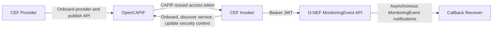

# CEF–CAPIF–O-NEF Integration

This repository contains the integration components required to expose an **O-NEF MonitoringEvent API through CAPIF** using a **CEF provider/invoker model**.

The implementation covers:

- CAPIF provider onboarding and service publication
- CAPIF invoker onboarding and service discovery
- CAPIF security-context creation and access-token retrieval
- RS256 JWT validation in O-NEF
- CAPIF AEF/API scope enforcement
- authenticated MonitoringEvent subscriptions
- asynchronous MonitoringEvent callbacks
- subscription cleanup after the final report
- TLS hostname and CA verification
- Robot Framework regression tests

The reference implementation has been validated end to end with TLS verification enabled.

> **Important**
>
> This repository is an integration package, not a complete OpenCAPIF or O-NEF distribution.  
> A target organization must provide its own OpenCAPIF deployment, O-NEF deployment, network configuration, identifiers, credentials, DNS/service discovery, and production PKI material.

---

## 1. Overview

The integration connects three main components:

- **CEF Provider** — onboards to CAPIF and publishes the O-NEF MonitoringEvent API.
- **CEF Invoker** — discovers the published API, establishes a CAPIF security context, and obtains a CAPIF-issued access token.
- **O-NEF** — verifies the CAPIF JWT and enforces the required CAPIF AEF/API scope before serving the MonitoringEvent request.

The CEF is the CAPIF-facing integration layer. It does not need to act as a reverse proxy for every API call. After service discovery and authorization, the invoker can call the O-NEF API directly with the CAPIF-issued Bearer token.

---

## 2. Scope and Assumptions

This repository assumes that the target environment already provides:

1. A reachable **OpenCAPIF** deployment.
2. A reachable **O-NEF** deployment exposing the MonitoringEvent API.
3. Network connectivity between CEF, OpenCAPIF, O-NEF, and the callback receiver.
4. CAPIF provider and invoker credentials.
5. A CAPIF-issued public key available to O-NEF for RS256 verification.
6. DNS names or service names that match the TLS certificates presented by CAPIF services.
7. Trusted CA certificates for the target deployment.
8. Location data required by the MonitoringEvent implementation.

Deployment-specific values must be supplied by the receiving organization. Examples include:

```
<CAPIF_HOST>
<REGISTER_HOST>
<CAPIF_REGISTER_PORT>
<AEF_ID>
<API_NAME>
<NEF_HOST>
<NEF_PORT>
<SCS_AS_ID>
<INVOKER_CONFIG_FILE>
<PROVIDER_CONFIG_FILE>
<CA_BUNDLE>
```

---

## 3. Architecture



### Request flow

1. The CEF provider onboards to CAPIF.
2. The provider publishes the O-NEF MonitoringEvent API.
3. The CEF invoker onboards to CAPIF.
4. The invoker discovers the published API.
5. CAPIF establishes or updates the invoker security context.
6. CAPIF issues an RS256 JWT access token.
7. The invoker calls O-NEF with the Bearer token.
8. O-NEF verifies the token and validates CAPIF scope.
9. O-NEF creates the MonitoringEvent subscription.
10. O-NEF sends asynchronous notifications.
11. The final notification contains `cancelInd=true`.
12. O-NEF removes the subscription after the final report.

The validated MonitoringEvent type is:

```
LOCATION_REPORTING
```

---

## 4. Repository Structure

```
.
├── capif/
│   └── register/
│       └── register_prepare.sh
│
├── cef/
│   ├── capif_compat.py
│   ├── certs/
│   │   ├── capif-root-ca.crt
│   │   ├── register-ca.crt
│   │   └── capif-ca-bundle.pem
│   ├── invoker/
│   │   ├── invoker_capif_connector.py
│   │   └── invoker_config_sample.json
│   ├── provider/
│   │   ├── provider_capif_connector.py
│   │   ├── provider_config_sample.json
│   │   └── openapi.yaml
│   ├── scripts/
│   │   └── refresh_capif_token.py
│   └── tests/
│       └── robot/
│           ├── capif_discovery.robot
│           ├── monitoring_event_e2e.robot
│           ├── nef_authorization.robot
│           ├── requirements.txt
│           └── resources/
│               ├── callback_receiver.py
│               ├── common.resource
│               └── seed_location.py
│
└── nef/
    ├── MonitoringEventAPI/
    │   └── app/
    │       └── auth.py
    └── docker-compose.cef.yaml
```

### Key files

| File | Purpose |
|---|---|
| `cef/capif_compat.py` | Compatibility and TLS handling for the CAPIF SDK integration |
| `cef/provider/provider_capif_connector.py` | Provider onboarding and service publication |
| `cef/invoker/invoker_capif_connector.py` | Invoker onboarding, discovery, and token-related flow |
| `cef/scripts/refresh_capif_token.py` | Reusable CAPIF discovery and token-refresh utility |
| `nef/MonitoringEventAPI/app/auth.py` | RS256 JWT verification and CAPIF scope authorization |
| `nef/docker-compose.cef.yaml` | O-NEF CAPIF/security deployment overlay |
| `capif/register/register_prepare.sh` | Reference Register TLS certificate preparation |
| `cef/tests/robot/` | Regression and end-to-end test suite |

---


## 5. Quick Start

### 5.1 Create local configuration files

Provider:

```bash
cp \
  cef/provider/provider_config_sample.json \
  cef/provider/provider_config.json
```

Invoker:

```bash
cp \
  cef/invoker/invoker_config_sample.json \
  cef/invoker/invoker_config.json
```

Edit both files for the target OpenCAPIF deployment.


### 5.2 Configure runtime environment

Example:

```bash
export CAPIF_HOST="<CAPIF_HOSTNAME>"
export REGISTER_HOST="<REGISTER_HOSTNAME>"
export CAPIF_REGISTER_PORT="<REGISTER_HTTPS_PORT>"

export CAPIF_GETAUTH_MODE="basic_get"

export CAPIF_TLS_VERIFY="True"
export CAPIF_CA_FILE="<ABSOLUTE_PATH_TO_CA_BUNDLE>"

export PROVIDER_CONFIG_FILE="$PWD/cef/provider/provider_config.json"
export INVOKER_CONFIG_FILE="$PWD/cef/invoker/invoker_config.json"
```

The hostnames must match the Subject Alternative Name (SAN) values in the certificates presented by the target CAPIF services.

### 5.3 Verify TLS before onboarding

CAPIF endpoint:

```bash
openssl s_client \
  -connect "${CAPIF_HOST}:443" \
  -servername "${CAPIF_HOST}" \
  -CAfile "${CAPIF_CA_FILE}" \
  -verify_hostname "${CAPIF_HOST}" \
  </dev/null 2>/dev/null \
| grep 'Verify return code'
```

Register endpoint:

```bash
openssl s_client \
  -connect "${REGISTER_HOST}:${CAPIF_REGISTER_PORT}" \
  -servername "${REGISTER_HOST}" \
  -CAfile "${CAPIF_CA_FILE}" \
  -verify_hostname "${REGISTER_HOST}" \
  </dev/null 2>/dev/null \
| grep 'Verify return code'
```

Expected:

```
Verify return code: 0 (ok)
```

Do not proceed with `CAPIF_TLS_VERIFY=True` until the required TLS endpoints validate successfully.

---

## 6. Configuration

### 6.1 Provider

The provider configuration template is:

```
cef/provider/provider_config_sample.json
```

Create a local copy:

```bash
cp \
  cef/provider/provider_config_sample.json \
  cef/provider/provider_config.json
```

Configure the values required by the target CAPIF deployment, including provider credentials and CAPIF connection details.

The provider connector is:

```
cef/provider/provider_capif_connector.py
```

It is responsible for:

- CAPIF provider onboarding;
- obtaining provider-side CAPIF identifiers;
- preparing the service description;
- publishing the API in CAPIF.

> **Stateful operation**
>
> Provider onboarding and publication create or modify CAPIF state. Do not use onboarding commands as health checks or repeatedly execute them in an already configured environment unless that behavior is intended.

---

### 7.1 Invoker

The invoker configuration template is:

```
cef/invoker/invoker_config_sample.json
```

Create a local copy:

```bash
cp \
  cef/invoker/invoker_config_sample.json \
  cef/invoker/invoker_config.json
```

The invoker connector is:

```
cef/invoker/invoker_capif_connector.py
```

The invoker flow performs:

- CAPIF invoker onboarding;
- service discovery;
- security-context establishment/update;
- access-token retrieval.

For an already onboarded invoker, use the reusable token-refresh script rather than creating new onboarding state.

---

### 7.2 O-NEF

CAPIF-aware authorization is implemented in:

```
nef/MonitoringEventAPI/app/auth.py
```

The O-NEF deployment must provide values equivalent to:

```
AUTH_ENABLED=True
ALGORITHM=RS256
PUB_KEY_PATH=<PATH_TO_CAPIF_PUBLIC_KEY>

CAPIF_ENFORCE_SCOPE=True
CAPIF_REQUIRED_API_NAME=<PUBLISHED_API_NAME>
CAPIF_REQUIRED_AEF_ID=<AEF_ID>
```

Example Compose fragment:

```yaml
environment:
  AUTH_ENABLED: "True"
  ALGORITHM: "RS256"
  PUB_KEY_PATH: "/app/certs/capif_security_server.pub.pem"

  CAPIF_ENFORCE_SCOPE: "True"
  CAPIF_REQUIRED_API_NAME: "<PUBLISHED_API_NAME>"
  CAPIF_REQUIRED_AEF_ID: "<AEF_ID>"
```

The required CAPIF scope is expected in the form:

```
3gpp#<AEF_ID>:<API_NAME>
```

The API name and AEF ID must correspond to the service actually published in the target CAPIF deployment.

---

### 7.3 TLS

#### Production recommendation

The target organization should use its own PKI and DNS/service-discovery configuration.

The files under:

```
cef/certs/
```

represent **reference PoC trust material** from the validated environment. They are not universal CAPIF certificates and should normally be replaced when deploying in another organization.

The reference bundle is:

```
cef/certs/capif-ca-bundle.pem
```

It contains public certificates only.

Check that a trust bundle does not contain a private key:

```bash
grep -E \
  'BEGIN .*PRIVATE KEY' \
  <CA_BUNDLE>
```

Expected:

```
<no output>
```

#### CAPIF Register reference script

```
capif/register/register_prepare.sh
```

The Register service:

- preserves its CA across restarts;
- preserves its server private key;
- generates a certificate with a DNS SAN;
- serves HTTPS using that certificate.


---

## 8. Running the Integration

### 8.1 Provider onboarding and publication

After configuring the provider:

```bash
export PROVIDER_CONFIG_FILE="$PWD/cef/provider/provider_config.json"
```

```bash
PYTHONPATH="$PWD/cef" \
python cef/provider/provider_capif_connector.py
```

This is a state-changing operation.

Run it only when provider onboarding/publication is required.

---

### 8.2 Invoker onboarding

After configuring the invoker:

```bash
export INVOKER_CONFIG_FILE="$PWD/cef/invoker/invoker_config.json"
```

Run the invoker connector when initial onboarding is required:

```bash
PYTHONPATH="$PWD/cef" \
python cef/invoker/invoker_capif_connector.py
```

Do not repeatedly onboard the same invoker solely to refresh an access token.

---

### 8.3 Refresh service discovery and access token

For an existing invoker:

```bash
export INVOKER_CONFIG_FILE="$PWD/cef/invoker/invoker_config.json"

PYTHONPATH="$PWD/cef" \
python cef/scripts/refresh_capif_token.py \
/tmp/cef_capif_token.txt
```

Expected output includes:

```
Running CAPIF service discovery...
Requesting CAPIF access token...
Discovery: OK
CAPIF JWT: received
JWT length: ...
```

The CAPIF SDK should also report successful discovery, security-context update, and token retrieval.

Protect temporary token files:

```bash
chmod 600 /tmp/cef_capif_token.txt
```

---

### 8.4 Invoke the MonitoringEvent API

Endpoint form:

```
POST /3gpp-monitoring-event-envelope/v1/{scsAsId}/subscriptions
```

Example body:

```json
{
  "msisdn": "<SUBSCRIBER_IDENTIFIER>",
  "notificationDestination": "http://<CALLBACK_HOST>:<CALLBACK_PORT>/notify",
  "monitoringType": "LOCATION_REPORTING",
  "maximumNumberOfReports": 2,
  "locationType": "CURRENT_LOCATION",
  "repPeriod": {
    "duration": 5
  }
}
```

Example invocation:

```bash
TOKEN="$(cat /tmp/cef_capif_token.txt)"

curl -i \
  -X POST \
  "http://<NEF_HOST>:<NEF_PORT>/3gpp-monitoring-event-envelope/v1/<SCS_AS_ID>/subscriptions" \
  -H "Authorization: Bearer ${TOKEN}" \
  -H "Content-Type: application/json" \
  --data @request.json
```

A successful subscription creation returns:

```text
201 Created
```

For the validated two-report flow:

```text
callback 1 -> cancelInd=false
callback 2 -> cancelInd=true
```

The subscription is then removed.

---

## 9. Running the Tests

Robot Framework tests are located in:

```text
cef/tests/robot/
```

### 9.1 Configure test variables

Before running the suite, review:

```
cef/tests/robot/resources/common.resource
```

The reference file may contain defaults from the original validation environment.

Replace or override values such as:

```
repository root
Python executable
invoker config file
CAPIF hostname
Register hostname
NEF base URL
NEF container name
Mongo container name
Docker network
callback container name
test subscriber identifier
wrong-scope token file
```


### 9.2 Full suite

From the repository root:

```bash
python -m robot \
  --outputdir cef/tests/robot/results \
  cef/tests/robot
```

Reference validation result:

```text
6 tests, 5 passed, 0 failed, 1 skipped
```

The skipped test was the optional real wrong-scope-token test.

### 9.3 Discovery test

```bash
python -m robot \
  --outputdir cef/tests/robot/results/discovery \
  cef/tests/robot/capif_discovery.robot
```

### 9.4 Authorization tests

```bash
python -m robot \
  --outputdir cef/tests/robot/results/auth \
  cef/tests/robot/nef_authorization.robot
```

The suite covers:

- missing Bearer token rejection;
- malformed/invalid JWT rejection;
- successful authorization with a correctly scoped CAPIF token;
- wrong-scope-token rejection when `WRONG_SCOPE_TOKEN_FILE` is supplied.

### 9.5 MonitoringEvent end-to-end test

```bash
python -m robot \
  --outputdir cef/tests/robot/results/e2e \
  cef/tests/robot/monitoring_event_e2e.robot
```

The E2E test validates:

- test location-data seeding;
- callback receiver startup;
- fresh CAPIF token retrieval;
- authenticated subscription creation;
- two asynchronous callbacks;
- `cancelInd=false` followed by `cancelInd=true`;
- O-NEF authorization;
- subscription cleanup.

---
