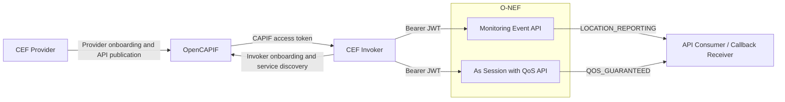

# CEF-CAPIF-O-NEF Integration

This repository contains the integration of the **CAPIF Exposing Function (CEF)**
with the imported **O-NEF** implementation and **OpenCAPIF**.

CEF provides the CAPIF-facing integration required to:

- onboard API Providers to CAPIF;
- publish O-NEF CAPIF-facing service APIs;
- onboard API Invokers;
- discover published O-NEF services;
- establish CAPIF security contexts;
- obtain CAPIF-issued access tokens;
- invoke CAPIF-facing O-NEF APIs using CAPIF Bearer tokens.

For the imported O-NEF release, CEF has been validated against all CAPIF-facing
northbound API families exposed by O-NEF:

- **3GPP Monitoring Event API**
- **3GPP As Session with QoS API**

Both API families have been validated for:

- CAPIF Provider onboarding and service publication;
- CAPIF Invoker onboarding and service discovery;
- CAPIF access-token issuance;
- RS256 JWT validation;
- API-specific CAPIF scope enforcement;
- POST, GET, PUT and DELETE operations;
- persistence after subscription updates;
- asynchronous notifications.

> **Important**
>
> The complete sanitized O-NEF source snapshot used by this integration is
> included under `o-nef/`.
>
> A target deployment must still provide its own OpenCAPIF configuration,
> credentials, networking, DNS/service discovery and production PKI material.
>
> Runtime-generated CAPIF state, private keys, JWTs, generated certificates and
> deployment-specific identifiers must not be committed to the repository.

---

## 1. Overview

The integration consists of three main functional components:

- **CEF Provider** - onboards to CAPIF and publishes CAPIF-facing O-NEF APIs.
- **CEF Invoker** - discovers the APIs, establishes CAPIF security contexts and
  obtains CAPIF access tokens.
- **O-NEF** - validates CAPIF JWTs and verifies that the token scope authorizes
  access to the requested API.

The CAPIF-facing O-NEF API families in the imported release are:

- `3gpp-monitoring-event/v1`
- `3gpp-as-session-with-qos/v1`

CEF acts as the CAPIF integration layer. It is not required to proxy every
O-NEF API request.

After discovery and authorization, an API consumer can call O-NEF using a
CAPIF-issued Bearer token.

Internal O-NEF management and simulation APIs remain internal and are not
CAPIF-published northbound service APIs.

---

## 2. Scope

The complete imported O-NEF source used by this integration is located under:

```text
o-nef/
```

The target environment must provide:

1. A reachable OpenCAPIF deployment.
2. Network connectivity between CEF, OpenCAPIF, O-NEF and callback receivers.
3. CAPIF Provider credentials.
4. CAPIF Invoker credentials.
5. The CAPIF security public key required for RS256 JWT validation.
6. Appropriate trusted CA certificates.
7. DNS or service names compatible with the TLS certificates.
8. Deployment-specific O-NEF subscriber, location and QoS data.

Deployment-specific identifiers must not be hardcoded into reusable repository
configuration.

Examples include:

```text
<CAPIF_HOST>
<REGISTER_HOST>
<CAPIF_REGISTER_PORT>
<PUBLISHED_MONITORING_EVENT_API_NAME>
<PUBLISHED_SESSION_WITH_QOS_API_NAME>
<AEF_ID>
<O_NEF_HOST>
<O_NEF_PORT>
<SCS_AS_ID>
<PROVIDER_CONFIG_FILE>
<INVOKER_CONFIG_FILE>
<CA_BUNDLE>
<CALLBACK_URL>
```

---

## 3. Architecture



### Request flow

1. The CEF Provider onboards to CAPIF.
2. The Provider publishes an O-NEF CAPIF-facing service.
3. The CEF Invoker onboards to CAPIF.
4. The Invoker discovers the published service.
5. CAPIF creates or updates the Invoker security context.
6. CAPIF issues an RS256 JWT access token.
7. The Invoker calls the corresponding O-NEF API using the Bearer token.
8. O-NEF validates the JWT.
9. O-NEF verifies that the JWT scope matches the requested API.
10. O-NEF processes the authorized request.
11. Where applicable, O-NEF sends an asynchronous notification.

A valid CAPIF token for one API cannot be reused against the other API.

For example:

```text
Monitoring JWT -> Monitoring API   allowed
Monitoring JWT -> QoS API          403

QoS JWT        -> QoS API          allowed
QoS JWT        -> Monitoring API   403
```

---

## 4. Repository Structure

Relevant repository structure:

```text
.
├── capif/
│   └── register/
│       └── register_prepare.sh
│
├── cef/
│   ├── capif_compat.py
│   ├── certs/
│   ├── invoker/
│   │   ├── invoker_capif_connector.py
│   │   └── invoker_config_sample.json
│   ├── provider/
│   │   ├── provider_capif_connector.py
│   │   ├── provider_config_sample.json
│   │   └── openapi.yaml
│   ├── scripts/
│   │   └── refresh_capif_token.py
│   └── tests/
│       └── robot/
│
├── o-nef/
│   ├── backend/
│   │   ├── Dockerfile.backend
│   │   └── app/
│   │       └── app/
│   │           ├── api/
│   │           │   ├── deps.py
│   │           │   └── api_v1/
│   │           │       └── endpoints/
│   │           │           ├── monitoringevent.py
│   │           │           └── qosMonitoring.py
│   │           ├── core/
│   │           │   └── security.py
│   │           ├── db/
│   │           │   └── session.py
│   │           ├── tools/
│   │           │   └── check_subscription.py
│   │           └── initial_data.py
│   └── UPSTREAM_IMPORT.md
│
├── nef/
│   └── MonitoringEventAPI/
│
├── docs/
│   └── CEF_ONEF_INTEGRATION.md
│
├── LICENSE
└── README.md
```

The `o-nef/` directory contains the imported O-NEF implementation used by the
current integration.

The `nef/MonitoringEventAPI/` directory contains earlier standalone
MonitoringEvent integration work and is retained as reference material.

### Key files

| File | Purpose |
|---|---|
| `cef/capif_compat.py` | CAPIF SDK compatibility and authentication handling |
| `cef/provider/provider_capif_connector.py` | Provider onboarding and service publication |
| `cef/invoker/invoker_capif_connector.py` | Invoker onboarding, discovery and token retrieval |
| `cef/scripts/refresh_capif_token.py` | CAPIF discovery and token refresh utility |
| `o-nef/backend/app/app/api/deps.py` | CAPIF JWT and API-scope authorization |
| `o-nef/backend/app/app/api/api_v1/endpoints/monitoringevent.py` | Monitoring Event API |
| `o-nef/backend/app/app/api/api_v1/endpoints/qosMonitoring.py` | As Session with QoS API |
| `o-nef/backend/app/app/core/security.py` | JWT/public-key security handling |
| `o-nef/backend/app/app/initial_data.py` | O-NEF initialization and CEF-managed CAPIF Provider handling |
| `o-nef/backend/app/app/db/session.py` | Database configuration |
| `o-nef/backend/app/app/tools/check_subscription.py` | Subscription-processing support |
| `o-nef/UPSTREAM_IMPORT.md` | Imported O-NEF provenance |
| `docs/CEF_ONEF_INTEGRATION.md` | Detailed integration documentation |

---

## 5. Configuration

### 5.1 CEF Provider

Create a local Provider configuration:

```bash
cp \
  cef/provider/provider_config_sample.json \
  cef/provider/provider_config.json
```

The Provider connector is:

```text
cef/provider/provider_capif_connector.py
```

The Provider performs:

- CAPIF Provider authentication;
- Provider onboarding;
- Provider-side CAPIF identifier retrieval;
- service-description preparation;
- O-NEF API publication.

Provider onboarding and publication modify CAPIF state and should not be used
as health checks.

### 5.2 CEF Invoker

Create a local Invoker configuration:

```bash
cp \
  cef/invoker/invoker_config_sample.json \
  cef/invoker/invoker_config.json
```

The Invoker connector is:

```text
cef/invoker/invoker_capif_connector.py
```

The Invoker performs:

- CAPIF Invoker onboarding;
- API discovery;
- security-context creation or update;
- CAPIF access-token retrieval.

The same CEF Invoker implementation has been validated with both O-NEF API
families.

### 5.3 O-NEF CAPIF configuration

CEF manages CAPIF Provider integration for the imported O-NEF deployment when:

```text
CEF_MANAGES_CAPIF_PROVIDER=true
```

O-NEF must also know the CAPIF API names under which its services were
published:

```text
CAPIF_MONITORING_EVENT_API_NAME=<PUBLISHED_MONITORING_EVENT_API_NAME>
CAPIF_SESSION_WITH_QOS_API_NAME=<PUBLISHED_SESSION_WITH_QOS_API_NAME>
```

Example Compose fragment:

```yaml
environment:
  CEF_MANAGES_CAPIF_PROVIDER: "true"

  CAPIF_MONITORING_EVENT_API_NAME: "<PUBLISHED_MONITORING_EVENT_API_NAME>"
  CAPIF_SESSION_WITH_QOS_API_NAME: "<PUBLISHED_SESSION_WITH_QOS_API_NAME>"
```

The API names are deployment-specific.

Do not commit generated API names as reusable defaults.

### 5.4 CAPIF authorization

CAPIF authorization for the imported O-NEF is implemented primarily in:

```text
o-nef/backend/app/app/api/deps.py
```

The expected CAPIF API scope follows the form:

```text
3gpp#<AEF_ID>:<API_NAME>
```

O-NEF first validates the JWT and then confirms that the token contains the
scope required by the requested API.

Expected behavior:

```text
No token                  -> 401 Unauthorized
Invalid token             -> 401 Unauthorized
Wrong API scope           -> 403 Forbidden
Correct API scope         -> request allowed
```

### 5.5 TLS

The target deployment should use its own PKI and DNS/service-discovery
configuration.

Reference PoC trust material is stored under:

```text
cef/certs/
```

Check that a CA bundle does not contain private-key material:

```bash
grep -E \
  'BEGIN .*PRIVATE KEY' \
  cef/certs/capif-ca-bundle.pem
```

Expected:

```text
<no output>
```

---

## 6. Running the CEF Integration

### 6.1 Provider onboarding and publication

Configure:

```bash
export PROVIDER_CONFIG_FILE="$PWD/cef/provider/provider_config.json"
```

Run:

```bash
PYTHONPATH="$PWD/cef" \
python cef/provider/provider_capif_connector.py
```

CEF Provider publication has been validated against both CAPIF-facing O-NEF
service families.

### 6.2 Invoker onboarding and token retrieval

Configure:

```bash
export INVOKER_CONFIG_FILE="$PWD/cef/invoker/invoker_config.json"
```

Run:

```bash
PYTHONPATH="$PWD/cef" \
python cef/invoker/invoker_capif_connector.py
```

For an already onboarded Invoker, the token-refresh utility can be used:

```bash
PYTHONPATH="$PWD/cef" \
python cef/scripts/refresh_capif_token.py \
  /tmp/cef_capif_token.txt
```

Protect temporary token files:

```bash
chmod 600 /tmp/cef_capif_token.txt
```

Never commit CAPIF JWTs.

---

## 7. O-NEF CAPIF-Facing APIs

### 7.1 Monitoring Event API

Collection:

```text
/nef/api/v1/3gpp-monitoring-event/v1/{scsAsId}/subscriptions
```

Supported operations:

```text
GET
POST
```

Individual subscription:

```text
/nef/api/v1/3gpp-monitoring-event/v1/{scsAsId}/subscriptions/{subscriptionId}
```

Supported operations:

```text
GET
PUT
DELETE
```

Example request:

```json
{
  "externalId": "<EXTERNAL_IDENTIFIER>",
  "notificationDestination": "http://<CALLBACK_HOST>:<CALLBACK_PORT>/notify",
  "monitoringType": "LOCATION_REPORTING",
  "maximumNumberOfReports": 5
}
```

Example invocation:

```bash
curl -k \
  -X POST \
  "https://<O_NEF_HOST>/nef/api/v1/3gpp-monitoring-event/v1/<SCS_AS_ID>/subscriptions" \
  -H "Authorization: Bearer ${MONITORING_CAPIF_TOKEN}" \
  -H "Content-Type: application/json" \
  --data @monitoring-request.json
```

Validated lifecycle:

```text
POST            -> 201
GET collection  -> 200
GET individual  -> 200
PUT             -> 200
GET after PUT   -> 200
DELETE          -> 200
```

Persistence was verified by modifying the subscription with PUT and confirming
the updated value using a separate GET request.

### 7.2 As Session with QoS API

Collection:

```text
/nef/api/v1/3gpp-as-session-with-qos/v1/{scsAsId}/subscriptions
```

Supported operations:

```text
GET
POST
```

Individual subscription:

```text
/nef/api/v1/3gpp-as-session-with-qos/v1/{scsAsId}/subscriptions/{subscriptionId}
```

Supported operations:

```text
GET
PUT
DELETE
```

Example request:

```json
{
  "ipv4Addr": "<UE_IPV4_ADDRESS>",
  "notificationDestination": "http://<CALLBACK_HOST>:<CALLBACK_PORT>/notify",
  "qosReference": 1,
  "qosMonInfo": {
    "reqQosMonParams": [
      "ROUND_TRIP"
    ],
    "repFreqs": [
      "EVENT_TRIGGERED"
    ]
  }
}
```

Example invocation:

```bash
curl -k \
  -X POST \
  "https://<O_NEF_HOST>/nef/api/v1/3gpp-as-session-with-qos/v1/<SCS_AS_ID>/subscriptions" \
  -H "Authorization: Bearer ${QOS_CAPIF_TOKEN}" \
  -H "Content-Type: application/json" \
  --data @qos-request.json
```

Validated lifecycle:

```text
POST            -> 201
GET collection  -> 200
GET individual  -> 200
PUT             -> 200
GET after PUT   -> 200
DELETE          -> 200
```

Persistence was also verified with a separate GET after PUT.

---

## 8. Asynchronous Notifications

Both CAPIF-facing API families were validated with asynchronous O-NEF
notifications.

A simulated UE movement triggered:

```text
Monitoring Event   -> LOCATION_REPORTING -> callback HTTP 200
Session with QoS   -> QOS_GUARANTEED     -> callback HTTP 200
```

The UE movement endpoint is an internal O-NEF simulation interface used to
trigger application behavior during testing. It is not a CAPIF-published
northbound API.

Detailed callback examples and the complete test procedure are documented in
[`docs/CEF_ONEF_INTEGRATION.md`](docs/CEF_ONEF_INTEGRATION.md).

---

## 9. Validation

The imported O-NEF release was validated end-to-end through CEF/OpenCAPIF:

| Validation | Monitoring Event | As Session with QoS |
|---|:---:|:---:|
| CEF Provider publication | PASS | PASS |
| CEF Invoker discovery | PASS | PASS |
| CAPIF token retrieval | PASS | PASS |
| Missing/invalid token rejection | PASS | PASS |
| API-specific scope enforcement | PASS | PASS |
| Cross-API token isolation | PASS | PASS |
| POST | PASS | PASS |
| GET collection | PASS | PASS |
| GET individual | PASS | PASS |
| PUT | PASS | PASS |
| Persistence after PUT | PASS | PASS |
| Asynchronous callback | PASS | PASS |
| DELETE | PASS | PASS |

For the tested O-NEF release:

> **CEF has been validated end-to-end against all CAPIF-facing northbound API
> families exposed by O-NEF.**

This applies to the CAPIF-facing service interface. Internal O-NEF management
and simulation APIs remain internal by design.

For detailed commands, payloads, callback traces and validation results, see
[`docs/CEF_ONEF_INTEGRATION.md`](docs/CEF_ONEF_INTEGRATION.md).

---

## 10. Tests

Robot Framework tests are available under:

```text
cef/tests/robot/
```

Existing tests include:

```text
capif_discovery.robot
monitoring_event_e2e.robot
nef_authorization.robot
```

These tests originate from the earlier standalone MonitoringEvent integration
and cover CAPIF discovery, authorization and MonitoringEvent end-to-end
behavior.

The imported O-NEF integration was additionally validated end-to-end for both
CAPIF-facing API families, including publication, discovery, API-specific
authorization, CRUD, persistence and asynchronous callbacks.

The existing Robot suite should therefore not be interpreted as complete
automated regression coverage for both imported O-NEF APIs.

See
[`docs/CEF_ONEF_INTEGRATION.md`](docs/CEF_ONEF_INTEGRATION.md)
for the complete validation procedure.

---

## 11. O-NEF Provenance

The source under:

```text
o-nef/
```

originates from the FRONT Research Group O-NEF project.

Imported upstream reference:

```text
Branch: main
Tag:    v2.2.3
Commit: 1656a2f68162b5359900dae743e24cf74009fcad
```

Exact provenance is documented in
[`o-nef/UPSTREAM_IMPORT.md`](o-nef/UPSTREAM_IMPORT.md).

Detailed integration documentation is available in
[`docs/CEF_ONEF_INTEGRATION.md`](docs/CEF_ONEF_INTEGRATION.md).

---

## 12. Security and Deployment Notes

Deployment-specific credentials and generated CAPIF state must not be committed.

This includes:

- CAPIF usernames and passwords;
- access tokens;
- Provider or Invoker private keys;
- generated identifiers and onboarding state;
- certificates containing private-key material;
- database credentials;
- temporary files containing secrets.

CAPIF endpoints, API names, certificates and runtime identifiers should remain
deployment-configurable.

The current implementation is a PoC/reference integration. Production
deployments should additionally address lifecycle automation, API cleanup,
production PKI and broader automated regression testing.

Further deployment details are documented in
[`docs/CEF_ONEF_INTEGRATION.md`](docs/CEF_ONEF_INTEGRATION.md).

---

## 13. Integration Status

The complete imported O-NEF source is included in this repository.

CEF/OpenCAPIF integration applies to the O-NEF APIs intended to be
CAPIF-facing:

```text
3GPP Monitoring Event API      PASS
3GPP As Session with QoS API   PASS
```

Both services were published and discovered using the same CEF Provider and
Invoker implementations and were validated for authentication, API-specific
authorization, CRUD, persistence and asynchronous notifications.

Internal O-NEF management and simulation APIs remain internal by design.

---

## 14. License

This repository is distributed under the Apache License 2.0.

See [`LICENSE`](LICENSE).

O-NEF upstream provenance is documented in
[`o-nef/UPSTREAM_IMPORT.md`](o-nef/UPSTREAM_IMPORT.md).
